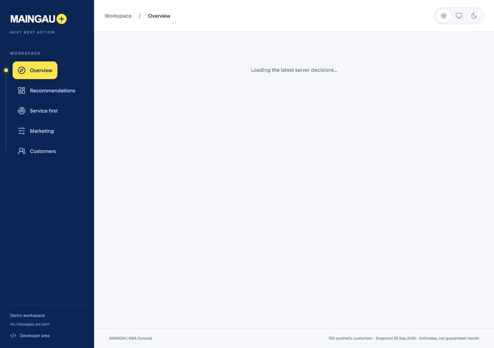
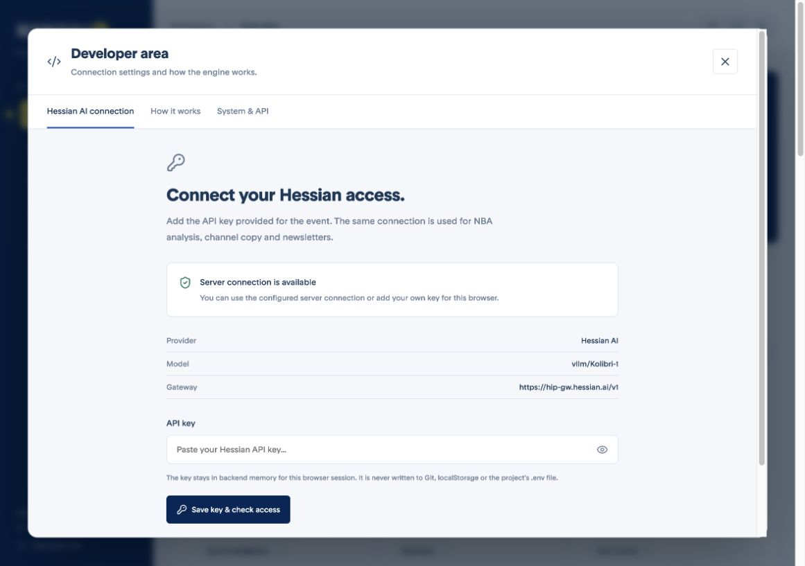
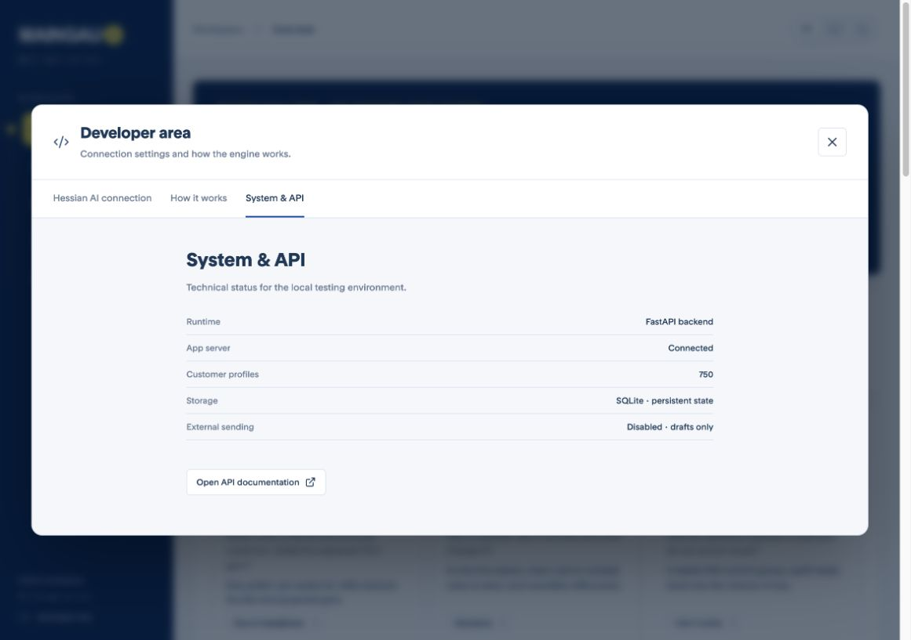

# MAINGAU Next Best Action

A customer intelligence and next-best-action workspace for **Futury Build Days #3**, built for MAINGAU's “One customer, every channel” challenge.

React + TypeScript on the frontend, FastAPI + SQLite on the backend. The rules engine provides a transparent baseline; Hessian AI evaluates customer needs across the enabled product catalogue and prepares channel-specific material. Both paths respect contact permissions, exclusions and economic checks. All customer data is synthetic event data. **Messages are drafts; external sending is disabled.**

## Architecture and source data

See [System architecture and data flows](docs/architecture.md) for diagrams of source ingestion, Customer 360, AI NBA selection, offer/call-kit generation, newsletter, caching and feedback. The Developer area's **How it works** also distinguishes the running MVP from the production target.

- **Recorded consent** comes from the original `consent_status` rows in SQLite. It is read only and shown separately from **Action availability**. A control group, missing app, contact cap or stale AI decision can block an action without changing consent.
- **Contact channel filters** in Customers match consent, newsletter double opt-in and portal/app availability. They do not require a generated offer and do not hide consented customers in the control group.
- Imported source rows reject updates/deletes; customer snapshot values are private and returned as detached copies. No AI or permission-edit endpoint writes consent.
- Browser GETs are deduplicated and reused in memory for 30 seconds (100-entry limit); successful writes invalidate the cache. Backend profile evaluation and SQLite-saved generations have separate version/fingerprint checks. Generation always rechecks current server policy.

For **MG-100126**, newsletter, portal/app personalisation and profiling are granted; marketing email, phone and SMS are not given. The customer is in the stable 10% control group. All 4,500 imported consent records were verified against the workbook without differences. Recheck without changing either file:

```bash
.venv/bin/python scripts/check_source_consents.py
```

## What is in the app

| Area | What it does |
| --- | --- |
| **Overview** | The presentation story, source-data findings, engine results and worked customer examples. |
| **Recommendations** | Engine decisions, channels, estimated company value and review status. |
| **Service first** | Case Radar for customers with an open complaint plus repeated unresolved contact or payment reminders. Radar action flags are local demo state, not a billing/service integration. |
| **Customers** | A directory of 750 mock profiles with search, filters, sorting, pagination and compact product/action/contact previews. |
| **Customer profile** | Recommendation and relevant source observations first; separate Overview, Offer studio, Products, Insights, History and Permissions sections. |
| **Offer studio** | Engine/AI comparison, concrete demo product quotes, branded HTML email, call scripts, web, push and SMS material. |
| **Developer area** | Hessian key connection, How it works, backend status and API documentation. Open it from the navigation footer or by double-clicking the logo. |

The header theme control has three modes: **sun = light**, **monitor = system**, **moon = dark**. Manual choices persist; system mode follows the device. Navigation can collapse into an icon rail.

## Run locally

Requirements: **Python 3.9+** and **Node.js 22.12+**.

### 1. Add the event dataset

Create a `data/` directory in the repository root and add:

- `maingau_nba_mockdata.xlsx`
- `event_stream_2026-10-01.jsonl`

Source data, SQLite databases, generated drafts and snapshots are excluded from Git. The dataset must be supplied separately by the team/organisers. On first startup, the backend imports it into `data/nba.sqlite`.

### 2. Install dependencies

```sh
python3 -m venv .venv
.venv/bin/pip install -r backend/requirements.txt
npm ci --prefix frontend
```

### 3. Start the backend

```sh
PYTHONPATH=backend .venv/bin/python -m uvicorn app.main:app --host 127.0.0.1 --port 8001 --reload
```

### 4. Start the frontend in another terminal

```sh
npm run dev --prefix frontend
```

Open **http://127.0.0.1:5173/**. Vite proxies `/api` to port 8001. The rules baseline works without an AI key; new AI generations require a Hessian connection.

## Add a Hessian API key through the UI

Use a valid key issued for your event/team access. The app does not create Hessian accounts or provision keys.

### 1. Open Developer area

Choose **Developer area** at the bottom of the navigation, or **double-click the MAINGAU logo**. On mobile, use the code icon in the header. The explicit button is also available for keyboard access.



### 2. Connect the key

In **Hessian AI connection**:

1. Paste the key into the masked **API key** field.
2. Select **Save key & check access**.
3. Wait for the access confirmation, then close Developer area.



The check calls the configured gateway's `/models` endpoint and verifies that the configured model is listed. Generate one NBA or material afterwards to check inference access as well; listing a model does not establish language quality or guarantee every generation will pass validation.

The key is held **only in backend memory for this browser session**, for up to **8 hours** or until the backend restarts. An HttpOnly, SameSite cookie identifies the session; the credential is not returned to the browser, stored in localStorage, written to `.env`/SQLite, included in audit logs or committed to Git. Other browser sessions keep their own credentials. Failed replacements retain the previous connection. **Use server default** removes the session key and returns to the server's environment configuration, if present. Batch workers use the initiating session's connection.

### 3. Inspect status or API docs

Open **System & API** inside Developer area. Runtime status, storage details and the API documentation link live here rather than in the business workspace header. **How it works** is the adjacent tab.



### Alternative: configure the root `.env`

Copy `.env.example` to **`.env` in the repository root**, next to this README. Do not overwrite an existing configured file. Add:

```dotenv
HAI_API_KEY=YOUR_HESSIAN_API_KEY
NBA_AI_BASE_URL=https://hip-gw.hessian.ai/v1
NBA_AI_MODEL=vllm/Kolibri-1
NBA_AI_TIMEOUT_SECONDS=90
NBA_AI_JSON_SCHEMA=1
```

**Restart the backend** after changing `.env`. Existing process environment variables take precedence over `.env`; a browser session key takes precedence over the server default. Never put a credential in a `VITE_` variable or frontend source.

More detail: [team setup and hosting](docs/team-setup.md).

### Connection troubleshooting

| Symptom | What to check |
| --- | --- |
| No AI connection | Start the backend, then connect a key in Developer area or set root `.env` and restart. |
| Key rejected / HTTP 401 or 403 | Check the issued key and its model permissions with the organiser. |
| HTTP 429 | The provider is limiting requests; wait before retrying. |
| Model not listed | The server model must be available to that credential; default is `vllm/Kolibri-1`. |
| Key disappeared after restart | Browser session keys are intentionally held in memory; reconnect or configure the server default. |
| Generation blocked after repairs | Inspect the readable reason and check details in Offer studio. Do not regenerate the NBA just to retry its text. |
| Static demo cannot connect | A GitHub Pages/snapshot build has no FastAPI backend and cannot make fresh AI generations. Use the full app. |

## Customer workflow

The directory searches IDs, cities and recorded product names. Filter by action, city, business line or profiling consent; sort by estimated gain, churn risk, customer value or ID. Twenty rows are rendered per page. Search, filters, pagination and the selected customer are reflected in the URL.

Open a customer to see the next step, why it was selected, relevant observations, current product information and contact context. **Back to customers** restores the directory/filter state. Neutral ID-based avatars are decorative identifiers; no names or real customer portraits are invented.

| Profile section | Contents |
| --- | --- |
| **Overview** | A current validated AI recommendation, or an explicitly labelled engine baseline, with relevant evidence and service alerts. |
| **Offer studio** | Prepare and inspect customer-facing material; engine and AI choices remain distinguishable. |
| **Products** | Known contracts, devices and purchases, plus externally reported products with evidence. A competing quote is not labelled as an existing external contract. |
| **Insights** | Observed usage/activity charts, source signals, engine alternatives and scoring. |
| **History** | Service interactions and earlier campaigns. |
| **Permissions** | Current AI channel eligibility, contact permissions, profiling consent and Du/Sie context. |

The directory explicitly shows **engine** decisions; the detail can show a separately labelled saved **AI** proposal. Consent granted alone does not guarantee a usable offer channel: the shared channel policy also checks product restrictions, current decision freshness, contact limits, value thresholds and holdout status.

Suggested presentation flow: open Customers, show the mobile example `MG-100005`, inspect Offer studio, then compare a service-first example `MG-100004`. Return to the directory without losing the filters. See [the UX review and jury walkthrough](docs/customer-experience-review.md).

## AI material and limits

- AI chooses from the full enabled catalogue; its comparison path does not reuse the 16 legacy product relevance triggers as mandatory filters.
- Source citations, policy gates and numeric claims are checked locally. Provenance checks do not establish the correctness of every model interpretation.
- Call material separates the internal customer brief from the spoken opening, discovery questions, service/offer pitch, objections and closing. Du/Sie checks apply to advisor-spoken copy.
- Outreach allows **one draft plus at most two content repairs**. It stops at the first valid result; provider failures stop immediately. If all content attempts fail, the UI shows reasons and an explicit manual retry without recalculating the NBA.
- Newsletter studio supports helpful informational updates independently of an NBA, and news-led commercial offers when the sales gates pass. Sources retain their publication dates; archived guides are not presented as breaking news.
- HTML email previews match the HTML part of downloaded multipart `.eml` drafts. The server renders the branded layout and quote; AI supplies copy. Individual mail clients have not been exhaustively tested.
- Observed portal activity is not confirmed availability. Three-month totals do not prove a pattern in every individual month. Demo prices and unknown contract terms are not binding offers.
- The source snapshot is fixed; this is not a live production customer platform. Sending is disabled. Event replay is a dry run, not persistent live ingestion. A/B/holdout analysis is not online model retraining.

See [the AI contract](docs/ai-nba.md).

## Tests and builds

```sh
.venv/bin/python -m pytest backend/tests -q
npm run build --prefix frontend
```

Integration tests use the supplied local dataset and an HTTP simulation of Hessian. Start it in another terminal:

```sh
postman simulation run postman/simulations/ai-nba.sim.yaml --port 4900
```

Then run:

```sh
NBA_TEST_PROVIDER_URL=http://127.0.0.1:4900/hessian/v1 .venv/bin/python -m pytest backend/tests -q
```

The fixture is for tests only; the running application never substitutes it for real AI. Coverage includes consent/exclusions, source provenance, channel consistency, bounded repairs, per-browser credentials, expiry, cross-origin rejection, secret-safe errors and batch credential propagation. The local full run for this version passed **124 tests**.

After a normal frontend build, FastAPI also serves the compiled app at **http://127.0.0.1:8001/**. For public hosting, add authenticated team access, HTTPS and request limits; the Developer area shortcut is a UI convenience, **not an authentication boundary**. Persist `data/` on the server. `NBA_PUBLIC_APP_URL` sets the public origin for demo CTA links and Developer area origin checks.

## Static demo / GitHub Pages

The static build reads an embedded snapshot and cannot call Hessian or persist server changes. New AI generation and key configuration are disabled. Build it with the full backend running:

```sh
python3 tools/static_demo/snap.py
(cd frontend && VITE_STATIC=1 npm run build -- --base ./ --outDir ../static-dist)
python3 tools/static_demo/inline.py static-dist snapshot.json.gz maingau-nba.html
```

The snapshot includes the directory, profile, products, channel context, newsletter context and saved materials. Generated snapshots contain event data and are excluded from Git. Session credentials are not part of the snapshot. The standalone HTML embeds fonts and declares UTF-8; approvals in the demo affect its browser session only.

## Repository map

```text
backend/app/
  engine/                  Customer state, signals, scoring, arbitration and templates
  service.py               Shared engine settings, reviews and overrides
  ai_nba.py                Hessian adapter, evidence checks, decisions and batches
  outreach.py              Concrete demo quotes and channel material
  material_generation.py   Bounded content repairs and readable failure reasons
  newsletter.py            Editorial sources and newsletter generation
  portfolio.py             Known/reported products and source evidence
  developer.py             Ephemeral browser-scoped Hessian credentials
  overview.py, radar.py    Overview metrics and stuck-service cases
  database.py, ingestion.py, replay.py
  main.py                  FastAPI API and optional compiled frontend hosting
backend/tests/             Unit and integration tests
frontend/src/
  pages/                   Overview, recommendations, service, marketing and customer workspace
  components/              Offer studio, directory/profile UI, theme/navigation and developer area
  theme.css, theme.ts       Light/dark/system tokens and preferences
  navigation.css           Collapsible navigation and cursor indicator
  customer-experience.css  Directory, profile and developer-area layouts
postman/                   Local provider mocks and simulations
tools/static_demo/        Snapshot capture and standalone HTML assembly
docs/                      AI contract, team setup, UX review and UI screenshots
legacy/                    Original implementations, retained for reference
```

Local SQLite persists engine settings, reviews, overrides, AI decisions, drafts, recorded products and editorial sources. Use `NBA_DB_PATH` to select another database file. The current app does not import the legacy engines.
