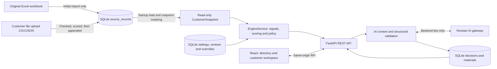
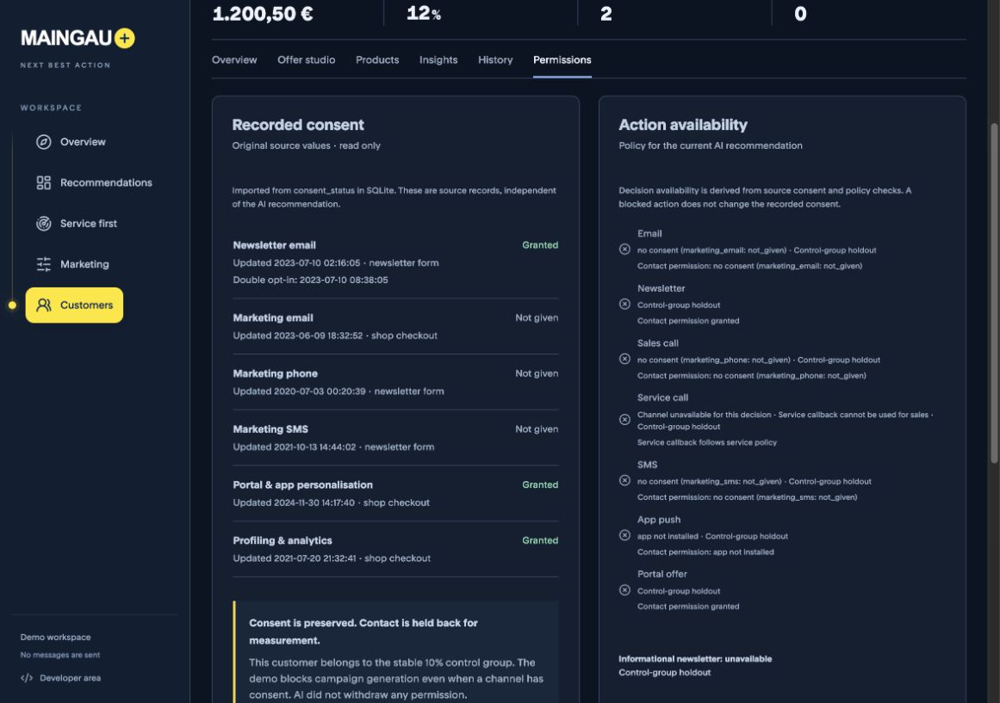
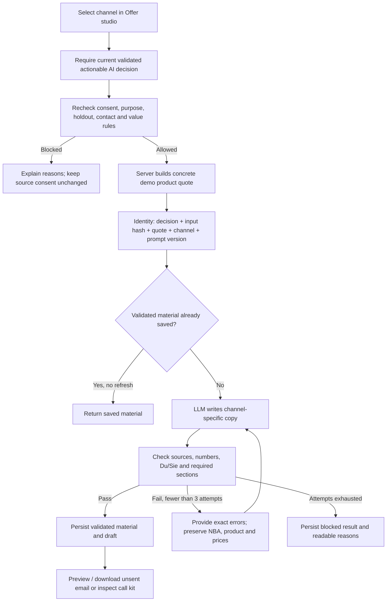

# System architecture and data flows

This describes the running MVP, not a proposed production platform. Snapshot: 30 September 2026. FastAPI owns the rules, data and model calls; React renders results and starts explicit operations. There is no automatic delivery or background retraining.

## Runtime and storage



The workbook is imported into `source_records` once, when that table is empty. Subsequent requests read the SQLite-backed snapshot, not Excel. Replacing the workbook does **not** replace the database automatically. A changed dataset requires an explicit migration or a separate fresh database, never deleting the working database to repair a UI misunderstanding.

`load_tables()` reconstructs tables at startup and applies observation-time masking: late charge records are excluded and service resolutions after the snapshot are treated as not yet resolved. `build_state()` joins by `customer_id`, derives features and creates one profile per customer. `CustomerSnapshot` stores private copies and returns detached records. Its public mapping has no assignment method. SQLite triggers reject updates/deletes to imported source rows. These are accidental-write safeguards, not an access-control boundary against an administrator who can alter the schema.

### Customer import

**Import customer** in the directory creates exactly one new customer from a CSV or JSON file (`POST /api/customers/import`, templates at `/api/customers/import/template?format=csv|json`). The flow:

1. **Check.** Every problem in the file is reported at once; nothing is written. Existing IDs are rejected, never overwritten. A missing consent is recorded as `not_given`, never as granted. Newsletter consent without a double opt-in date leaves the newsletter channel blocked.
2. **Score before storing.** The server builds a candidate engine with the new rows and evaluates the customer. Only if that succeeds are the rows committed, because stored source rows can never be removed again. The preview shows the engine's next action.
3. **Append.** One `customer_master`, one `customer_value` and six `consent_status` rows are inserted with `origin='upload'` (workbook rows keep `origin='workbook'`), plus a `customer_imported` audit entry with the file's SHA-256. The candidate engine then replaces the running one.

A new customer has no contracts: margin, costs and CLV start at 0, churn at the portfolio median (`model_version: new_customer_default_v1`). The consent integrity check compares only `origin='workbook'` rows with the workbook.

**Known limitation:** the upload records a new customer's *initial* consents with `source: data_import`, without authentication or consent evidence. It cannot change any existing consent. In production this path needs the same safeguards as a consent writer below.

Consent has no edit endpoint in this MVP. A future consent writer needs authenticated events, evidence, effective timestamps, audit, a new snapshot version and cache invalidation. AI and offer generation have no authority to change source consent.

## What the screens mean

| Data | Built from | Persistence / refresh |
| --- | --- | --- |
| Recorded consent | Exact `consent_status` values, dates, source and newsletter double opt-in | Imported SQLite snapshot; no LLM and no regeneration |
| Contact channel availability | Consent + newsletter DOI + portal account / installed app | Deterministic channel checks; not dependent on an AI proposal |
| Action availability | Contact checks + current validated proposal + service/sales purpose + product/value policy + control group | Rechecked by backend before material generation |
| Customer 360 | Master data, active contracts, usage, service and historical interactions | Startup snapshot, cached evaluation, detached API responses |
| Signals, churn and CLV | Source observations and explicit scoring assumptions | Deterministic estimates, not predictions generated by the LLM |
| Engine next action | Signal candidates, service rules, channel economics and arbitration | In-memory cache keyed by settings version and overrides |
| AI next action | Full supplied product catalogue + permitted source facts + policy and economics | `ai_decisions`; input fingerprint detects stale results |
| Current products | Imported contracts and devices, plus explicitly added external-product evidence | Source tables + `external_products`; external information is separately attributed |
| Outreach copy | Validated AI proposal, server quote, tone and permitted channel | `outreach_materials`, with draft email in `drafts` when applicable |
| Editorial newsletter | Selected news source, purpose, profile and separate newsletter checks | `newsletter_materials`, source items in `news_items` |
| Overview / Service first | Aggregates of evaluated profiles, cases and source observations | Computed server-side; no client-owned business rules |
| Event replay | JSONL events applied to detached working copies | Dry run only; does not update live consent or customer state |

### Example: MG-100126

All 4,500 imported consent rows were compared with the supplied workbook and match. For this customer:

- Newsletter: **granted**, double opt-in recorded.
- Portal/app personalisation: **granted**; profiling: **granted**.
- Marketing email, phone and SMS: **not_given**.
- A stable hash assigns this customer to the **10% control group**. The policy deliberately blocks campaign generation, including the editorial newsletter, without changing the recorded consent.

The Permissions screen therefore shows **Recorded consent** separately from **Action availability**.



 The directory's Contact channel filter uses contact checks, so this customer can match Newsletter or Portal even though campaign generation is held back. App push additionally requires an installed app. Service callback is a case-specific action, not a blanket marketing consent channel.

## Recommendations versus channel restrictions

For a validated **service** decision, the callback is marked **Recommended now**. Other channels that pass their consent/account and policy checks remain **Available alternatives**, including SMS and phone. Choosing another channel retains the service purpose; it does not turn the message into a sale. The writer receives this purpose explicitly. The studio shows the preferred channel and lets the operator choose an alternative. Phone is presented once as **Call**; service and sales are purposes, not two contact channels. The UI maps Call to the callback flow for a service NBA and to the sales-call flow for an offer NBA.

Missing/withdrawn consent, disabled channels, stale/invalid decisions and holdout remain real restrictions. Newsletter generation keeps its separate consent/DOI and editorial checks. Product/value constraints still apply to sales proposals. This change softens the service-channel preference, not every business or consent gate.

## Flow: choose an AI next best action

```mermaid
sequenceDiagram
    participant U as User / React
    participant A as FastAPI
    participant E as Engine + source snapshot
    participant D as SQLite
    participant H as Hessian AI
    U->>A: Generate NBA (refresh=false)
    A->>E: Build facts, catalogue, tone, policy and economics
    A->>A: Fingerprint inputs and acquire customer lock
    A->>D: Read latest saved decision
    alt Matching reusable decision
        D-->>U: Saved result; no model call
    else New inputs or explicit rethink
        A->>H: Structured proposal request (source data is untrusted content)
        H-->>A: Action, product, channel, reasoning, evidence
        A->>A: Validate schema, evidence and policy; bounded repair where supported
        A->>D: Save validated / blocked / failed result and audit
        A-->>U: Result and status; nothing sent
    end
```

The AI selector evaluates the supplied catalogue rather than inheriting the engine's hardcoded signal-to-product shortlist. Deterministic calculations still provide economics and enforce constraints. The engine baseline remains a labelled comparison and powers the directory. These are two selection modes over shared source data and policy, not two independent copies of customer permissions.

A saved AI decision is current only when its fingerprint still matches its input context. Settings, source facts, catalogue/provider/prompt context can invalidate it. Blocked decisions are stored too; a visible result does not imply permission to contact.

## Flow: generate a concrete offer or call kit



Email uses the customer’s preferred English or German language inside the branded HTML template. Call kits separate the internal brief from spoken opening, discovery, pitch, objections and closing. Portal, push and SMS use their own format and length checks. At most **one draft plus two copy repairs** run; provider failure stops the run. Copy repair does not recalculate the NBA or weaken validation. Demo tariffs and availability still require verification. There is no send connector.

## Flow: newsletter and feedback

Editorial newsletter generation checks newsletter consent, double opt-in, contact limit, control group and selected source/purpose independently of the sales proposal. A source-led product offer must also satisfy its product/personalisation rules. The selected article's date and evidence are preserved; old guidance is not presented as breaking news.

Demo responses (`interested` / `not_now`) are audit events. Reviews and overrides are separate records; an override must pass current gates. They do not rewrite source consent, create contracts, deliver messages or train the model online. Historical acceptance estimates are computed from supplied, sufficiently mature action history; live causal uplift learning is future work.

## Customer language contract

The imported `preferred_contact_language` is authoritative for generated communication (supported: `de`, `en`). The operator interface stays English. `communication.py` normalises the language, supplies an explicit writer instruction and conservatively checks common wrong-language output; it is a heuristic, not a complete language detector. German source records and product names never select the writing language. Du/Sie validation applies only to German; English uses informal or professional register.

Language travels through AI email generation, outreach and newsletters, saved material metadata, HTML `lang` and fixed copy, and frontend offer labels. Currency claims are checked in both prefix (`€14.99`) and suffix (`14,99 €`) forms. Copy repair preserves language and retains the existing attempt bound. Context/material fingerprints include the communication version and language. Legacy German materials are not current for English customers, and generation checks remain server-side. Source preferences are not edited.

## Caching and invalidation

1. **Source layer:** SQLite is loaded once at server startup into a private snapshot. Restart reloads SQLite; it does not reimport a nonempty database.
2. **Evaluation layer:** `EngineService` caches computed profiles by settings version and overrides. A single-customer request copies only that profile, not all 750. Review status is overlaid from its own records. Returned objects cannot mutate cached source values.
3. **Generated layer:** decisions, channel materials and newsletters persist in SQLite. Reuse requires their input identity/fingerprint and the appropriate status. Generation rechecks current server rules before reuse.
4. **Browser layer:** `useApi` shares in-flight GETs and caches successful reads in memory for **30 seconds**, with a **100-entry bound**, keyed by route and revision. No key or customer data is saved to localStorage by this cache. Successful mutations invalidate the read cache; explicit revisions force a new read. Remounting within the cache lifetime reuses data. There is no offline or cross-device cache.

Cached display data is never authority to contact a customer. The backend always checks eligibility at generation time. Production consent updates would require immediate server invalidation and cross-process propagation; this MVP has a fixed snapshot and one backend process.

## Access and deployment limits

Hessian keys entered in Developer area are stored only in backend memory, selected through an HttpOnly browser session cookie, expire after eight hours and are isolated per browser. The backend `.env` key remains the optional fallback. No key is sent to the model as customer data or committed in Git.

The current MVP does not implement user/role authentication, a live consent event consumer, scheduled nightly jobs, Databricks, MCP tools, delivery or online retraining. A static build uses exported demo data and cannot make live model calls. These distinctions also apply to any presentation of the platform.
